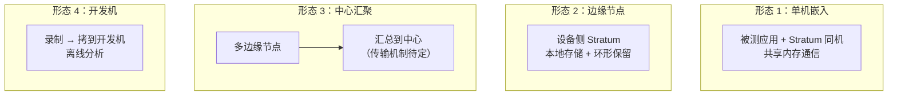

# Stratum 部署与运行形态场景 v0.1（草案待评审）

> 文件名：`07-deployment.md`
> 状态：**草案，未评审**
> 说明：前面几份文档讨论"录什么、怎么放、可不可信"。
> 本文讨论**"在哪里跑、跑多久、谁来管"**——这类场景最容易被漏，但直接决定可用性设计。

---

## 1 部署形态总览

| 形态 | 特征 | v1 支持 |
|---|---|---|
| **单机嵌入** | 与被测应用同机，最简 | ✅ 主要目标 |
| **边缘节点** | 资源受限、长期运行 | ✅ 支持（需资源限制） |
| **中心汇聚** | 多节点数据汇总 | ⚠️ v1 只保证"产物可拷贝"，不做自动汇聚 |
| **开发机离线** | 拷走后分析 | ✅ 必须支持（自描述格式） |

---

## 2 运行时长场景

### DP-01 短时录制（分钟级）【常见】

**场景**：临时抓一段，调试用。

**要求**：
- 启动快（< 1s）
- 不需要复杂的保留策略
- **Ctrl+C 能干净退出**（不能留损坏文件）

---

### DP-02 长期常开（天到月级）【P0，黑匣子的本质】

**场景**：SC-01 黑匣子，装上就不关了。

**这是最考验设计的场景**，要求：

| 要求 | 说明 |
|---|---|
| **零人工干预** | 不能需要每天重启、清理 |
| **容量自管理** | 靠环形保留自动控制，不能写满磁盘（EC-11） |
| **性能不退化** | LSM compaction 不能导致长期吞吐下降（NFR-1.1 的 24h 要求，实际应更长） |
| **内存不泄漏** | 长期运行的稳定性 |
| **崩溃自恢复** | 崩了要能自动重启继续（取决于外部守护，见 DP-07） |

**⚠️ 我的判断**：**这个场景应该作为 v1 的首要设计目标**，因为：
- 它最难（所有边缘情况都会暴露）
- 它是黑匣子价值的根本（不能常开就没有黑匣子）

**但要注意**："长期常开"和"快速交付"是矛盾的。
建议：**v1 先做到"能连续跑 24 小时不出问题"**，把"月级"作为验证目标而非首版承诺。

---

### DP-03 触发式录制（按需启动）【P2】

**场景**：平时不录，检测到异常才启动。

**矛盾**：**等你发现异常，现场已经过去了**（这正是 SC-01 的痛点）。

**所以这个形态价值有限**——除非"触发"来自系统外部的预警信号。

**可能的形态**：
- 平时只录**关键话题的环形窗口**
- 收到外部触发信号 → 把窗口固化 + 继续录一段时间

**这与 SC-03 的"触发式固化"是同一个能力**（`Q25`）。v1 不做。

---

## 3 资源受限场景

### DP-04 磁盘容量有限【P0】

**场景**：边缘设备只有几十 GB 可用空间。

**要求**：
- 保留策略必须**精确可控**（`NFR-2.4` 的确定性要求）
- 启动时**校验配置与容量的匹配**（`EC-17`）
- 空间不足时的降级行为要明确（`Q33`）

**⚠️ 现实提醒**：这是**长期部署中最常见的失效原因**——
不是软件 bug，是磁盘满了。所以：
- 必须能**远程查询**当前占用（`NFR-5.1`）
- 占用超过阈值应**主动告警**（不是等用户去看）

---

### DP-05 CPU / 内存受限【P1】

**场景**：边缘设备本身就跑着业务，Stratum 只能分到很少资源。

**要求**：
- 资源占用可配置上限（`NFR-4`）
- 压缩、索引构建等**可以降级或延后**
- **绝不能因为 Stratum 抢占资源导致业务受影响**（`NFR-1.2` 是硬约束）

---

### DP-06 容器化部署【P1】

**场景**：用 Docker/K8s 部署。

**新增要求**：

| 要求 | 说明 |
|---|---|
| 存储**必须在挂载卷上** | 容器重启不能丢数据 |
| 优雅停止要响应 SIGTERM | K8s 会先发 SIGTERM 再 SIGKILL（宽限期默认 30s）→ **必须在这个窗口内完成落盘** |
| 资源限制要适配 | 容器的 memory limit 会导致 OOM kill → 缓冲上限要低于 limit |
| 日志要能输出到 stdout | 容器惯例 |
| ⚠️ 多副本不能同时挂同一卷 | 会导致文件锁冲突（`EC-15`） |

**⚠️ SIGTERM 处理这条很重要**：如果处理不当，K8s 滚动更新时每次都会丢最后一段数据。

---

## 4 运维场景

### DP-07 无人值守与自动恢复【P0，长期部署必需】

**场景**：设备在现场，没人管。

**要求**：
- 崩溃后能**自动重启并继续录制**（需要外部守护，或用 systemd 的 `Restart=always`）
- 重启后**不能丢失配置**（`DP-10`）
- 重启事件要记录（`RC-6`、`Q37`）

**⚠️ 设计决策**：自动重启是**Stratum 自己实现**（守护进程），还是**交给 systemd/k8s**？

**我的建议**：**交给外部**（systemd/k8s）。理由：进程守护是操作系统该干的事，
自己实现会引入复杂度且不可靠。但 Stratum 必须**配合好**：
- 快速优雅退出（配合 `DP-06`）
- 崩溃后能打开已有 Session 并继续（`Q37`）

---

### DP-08 远程运维与监控【P1】

**场景**：设备在现场，运维在办公室。

**要求**：
- 状态**可远程查询**（`NFR-5.1` 的指标要能以某种方式暴露）
- 告警能推送出去
- ⚠️ 通过什么通道？（HTTP 接口？写文件由外部采集？DDS 自己发？）→ **新增开放问题 Q42**

**⚠️ 注意矛盾**：如果 Stratum 通过 DDS 暴露自己的状态，
那"监控 Stratum 的话题"本身也会被录制 → **自指问题**。

---

### DP-09 多实例共存【P2】

**场景**：一台机器上跑多个 Stratum 实例（不同应用各自录制）。

**要求**：
- 实例间**隔离**（不同存储位置、不同锁）
- 资源分配要可控（否则互相抢磁盘）

---

### DP-10 配置管理【P1，容易被漏】

**场景**：录制器长期运行，配置是几个月前设的。

**问题**：
- 谁改过配置？什么时候改的？
- 当前生效的配置是什么？
- 配置丢了怎么办？

**要求**：
- **配置必须可查询**（不只存在于启动参数里）
- 配置应**随 Session 一起记录**（否则后人无法知道"当时是怎么录的"）
- ⚠️ 配置变更应记录（用于归因"为什么这段时间数据不一样"）

**第三条特别重要**：设想一个场景——某天开始数据明显变少，
查了半天发现是**有人改了录制的话题配置**。
如果配置变了没记录，这种问题极难排查。

---

## 5 数据流转场景

### DP-11 录制产物搬移【P0】

**场景**：从设备拷到开发机分析。

**要求**：
- **自描述**：拷贝后不需要原环境即可读取（`FR-S-1`）
- **可校验**：拷贝后能验证完整性（`NFR-2.3`）
- **可部分拷贝**：能只拷某个时间段/话题（`FR-M-2` 的裁剪）

**⚠️ 现实问题**：拷贝大文件（几十 GB）容易中断。
要求"断点续传"？还是"分片小一点便于重传"？→ 与分片策略相关（`FR-R-8`）。

---

### DP-12 跨机器回放【P1】

**场景**：A 机器录制的数据，在 B 机器回放。

**要求**：
- 产物跨机器可读（无绝对路径依赖）
- ⚠️ **时钟基准问题**：B 机器的时钟与 A 不同 → 回放的"绝对时间"含义变了
- 时间戳应表达为"相对 Session 起点"还是"绝对时间"？→ **新增开放问题 Q43**

**⚠️ 这是个容易忽略的点**：如果时间戳都存绝对时间（如 Unix 纳秒），
跨机器回放时"下午 3 点"就变成 B 机器的下午 3 点，可能造成困惑。

---

### DP-13 数据归档与冷存【P2】

**场景**：录制数据要保存数年（审计）。

**要求**：
- 格式**长期可读**（不依赖特定软件版本）
- 文档化格式规范（`NFR-6.2` 已要求）
- ⚠️ 是否需要导出成通用格式（如 CSV/MCAP）？→ **新增开放问题 Q44**

---

## 6 开发与调试场景

### DP-14 开发机本地试验【P0】

**场景**：开发者在自己机器上试功能。

**要求**：
- **不依赖真实 DDS 环境**也能跑（`NFR-6.3` 的可测试性）
- 提供"生成模拟数据"的能力（否则没法测）
- 快速反馈（启动快、不需要配置）

**⚠️ 这条常被忽略但很重要**：如果开发者必须搭一套完整 DDS 环境才能试 Stratum，
开发效率会极低。**建议提供 `stratum generate` 之类的模拟数据生成能力。**

---

### DP-15 CI 集成【P1】

**场景**：在 CI 中跑回放测试。

**要求**：
- 命令行**返回明确退出码**（`FR-M-3` 已要求）
- 输出**机器可解析**（便于 CI 判断）
- **可加速**（否则 CI 时间长，`FR-P-2`）
- **可重复**（同样输入同样结果，`C5` 约束）

---

## 7 部署场景反推出的设计约束

| # | 约束 | 来源 |
|---|---|---|
| D1 | 必须支持**长期常开**（首要设计目标） | DP-02 |
| D2 | 磁盘占用必须**确定性可控** + **可远程查询** | DP-04、DP-08 |
| D3 | 必须响应 **SIGTERM** 并在宽限期内完成落盘 | DP-06 |
| D4 | 崩溃后能**继续录制**（不能每次新建 Session 导致碎片） | DP-07、Q37 |
| D5 | **配置必须随 Session 记录**（含变更历史） | DP-10 |
| D6 | 产物必须**自描述 + 可校验 + 可部分拷贝** | DP-11 |
| D7 | 必须提供**模拟数据生成**能力（开发/测试） | DP-14 |
| D8 | 时间戳语义要明确**绝对 vs 相对** | DP-12、Q43 |
| D9 | 资源占用**可配置上限**，且不挤占业务 | DP-05 |
| D10 | 状态暴露要避免**自指问题**（监控数据被自己录下来） | DP-08 |

---

## 8 本文档引出的新开放问题

| ID | 问题 | 关联 |
|---|---|---|
| Q42 | 运行状态通过什么通道暴露（HTTP / 文件 / DDS）？ | DP-08 |
| Q43 | 时间戳存**绝对时间**还是**相对 Session 起点**？ | DP-12 |
| Q44 | 是否需要导出**通用格式**（CSV / MCAP / Parquet）？ | DP-13 |
| Q45 | 是否自实现进程守护，还是交给 systemd/k8s？ | DP-07 |
| Q46 | 是否需要 `stratum generate` 模拟数据能力？ | DP-14 |

---

## 9 一个部署视角的观察

把本文和前面的边缘场景文档（`05-edge-cases.md`）放在一起看，有一个模式：

> **真正会让 Stratum 在现场失效的，几乎都不是"功能不完整"，
> 而是"长期运行中的运维问题"：磁盘满、崩溃后没恢复、配置漂移、SIGTERM 没处理。**

这提示设计优先级：

| 优先级 | 做什么 |
|---|---|
| **最高** | 长期运行的健壮性（容量、恢复、退出、配置） |
| **其次** | 数据可信度（`06-data-trust.md`） |
| **再次** | 功能完整度（QoS 覆盖、协议兼容） |

**这与我之前"先做窄而稳的闭环"的建议是一致的**——
窄，意味着功能面小；稳，意味着长期运行不出问题。
